 

### Votre parcours au sein du club, dans votre poche.

Séances, présences, notes et planning. 
Fonctionne hors ligne, synchronise automatiquement.

 

 

[Présentation](#présentation) &nbsp;&nbsp;|&nbsp;&nbsp;
[Version 2.1](#version-21) &nbsp;&nbsp;|&nbsp;&nbsp;
[Profils](#profils-et-droits) &nbsp;&nbsp;|&nbsp;&nbsp;
[Installation](#installation) &nbsp;&nbsp;|&nbsp;&nbsp;
[Support](#support)

 

 

> [!IMPORTANT]
> **La mise à jour vers la version 2.1.0 est obligatoire.**
> Les versions précédentes, dont la 2.0.0, ne peuvent plus communiquer avec les serveurs du club et affichent un écran de mise à jour dès l'ouverture.

 

## Présentation

MyDIC est l'application mobile officielle du **Digital Innovation Club**. Elle réunit au même endroit tout ce dont un membre, un chef de pôle ou le bureau a besoin au quotidien.

<table>
  <tr>
    <td width="33%" valign="top">
      <b>Suivi des séances</b>
        
      Chaque séance est enregistrée avec sa feuille de présence et son compte rendu, pour un historique complet du parcours.
    </td>
    <td width="33%" valign="top">
      <b>QR code personnel</b>
        
      Un code unique pour valider sa présence en un instant, régénérable à tout moment en cas de doute.
    </td>
    <td width="33%" valign="top">
      <b>Notes et progression</b>
        
      Notes par évaluation, moyenne, classement dans le pôle et bonus reçus, mis à jour en temps réel.
    </td>
  </tr>
  <tr>
    <td width="33%" valign="top">
      <b>Planning hebdomadaire</b>
        
      Jours, horaires et salles des créneaux du pôle, réunis au même endroit.
    </td>
    <td width="33%" valign="top">
      <b>Mode hors ligne</b>
        
      L'application reste utilisable sans réseau et se synchronise automatiquement au retour de la connexion.
    </td>
    <td width="33%" valign="top">
      <b>Échanges sécurisés</b>
        
      Chaque échange avec les serveurs est signé et vérifié, et les actions critiques demandent une confirmation.
    </td>
  </tr>
</table>

 

 

## Version 2.1

La version 2.1 corrige les problèmes signalés après la 2.0, renforce la sécurité des échanges et rend les retours faits à l'utilisateur plus clairs.

<table>
  <tr>
    <td align="center" width="25%">
      <h2>7</h2>
      CORRECTIFS BLOQUANTS
    </td>
    <td align="center" width="25%">
      <h2>13</h2>
      ACTIONS CRITIQUES PROTÉGÉES
    </td>
    <td align="center" width="25%">
      <h2>9</h2>
      ERREURS MÉTIER EXPLICITES
    </td>
    <td align="center" width="25%">
      <h2>5</h2>
      NOUVEAUX TYPES DE NOTIFICATION
    </td>
  </tr>
</table>

### Nouveautés

| | |
| :-- | :-- |
| **Vérification de version au démarrage** | L'application contrôle sa version à l'ouverture et à chaque retour du réseau. Si elle est obsolète, l'écran de mise à jour s'affiche avant même la connexion. |
| **Écran « Compte désactivé »** | Lorsqu'un compte est désactivé par l'administration, un écran dédié propose la déconnexion, au lieu d'un message d'erreur générique. |
| **Confirmations visuelles** | Les actions ponctuelles (création d'un rapport, validation d'une présence, etc.) affichent une notification de succès ou d'erreur. |
| **Messages de connexion explicites** | « Identifiants incorrects » remplace l'ancien message générique, et un compte désactivé est distingué d'un mauvais mot de passe. |

### Sécurité

| Mécanisme | Effet |
| :-- | :-- |
| Identification de la version et de la plateforme | Le serveur refuse les clients dont la version est obsolète. |
| Signature des requêtes de modification | Garantit l'intégrité des envois et protège contre le rejeu de requêtes. |
| Confirmation par mot de passe | Demandée pour 13 actions critiques : suppressions, changements de rôle, bannissements, recalages. |
| Écran de mise à jour bloquant | Une version obsolète est inutilisable tant que la mise à jour n'est pas faite. |

<b>Corrections apportées depuis la 2.0.0</b>

 

| Problème constaté | Statut |
| :-- | :-- |
| « Aucun membre actif » affiché alors que des membres existent | Corrigé |
| Page Rapports vide malgré des rapports existants | Corrigé |
| Création de rapport signalée en échec alors qu'elle avait réussi | Corrigé |
| Impossible de charger les séances | Corrigé |
| Notifications restant non lues après leur marquage | Corrigé |
| Membre désactivé encore visible dans les présences | Corrigé |
| Impossible de charger les rapports | Corrigé |

<b>Autres améliorations</b>

 

- **Écran d'erreur global** : toute erreur d'affichage présente un message clair avec un bouton pour recharger, à la place d'une page blanche.
- **Restauration des bonus** : un bonus supprimé peut être restauré, et les notes ne sont plus détruites.
- **Relevé de notes étendu** : les pôles terminés ou quittés apparaissent dans le relevé avec un badge de statut, pour conserver l'historique.
- **Erreurs explicites** : neuf cas métier (chevauchement de créneaux, planning en doublon, année non vide, etc.) affichent un message précis et une action corrective.
- **Nouvelles notifications** : inscription demandée, acceptée, refusée, bannissement et réintégration, chacune avec un lien vers la page concernée.

 

 

## Profils et droits

L'application s'adapte automatiquement au rôle de chaque utilisateur au sein du club.

| Profil | Fonctionnalités |
| :-- | :-- |
| **Membres** | Consultation des notes, des présences, du planning et du QR code personnel. |
| **Chefs de pôle et adjoints** | Gestion des séances, prise de présence (manuelle ou par scan), saisie des notes, proposition de plannings. |
| **Bureau et direction** | Administration complète du club : pôles, utilisateurs, candidatures, événements et plus encore. |

 

## Installation

1. Vérifiez que l'appareil respecte la [configuration requise](#configuration-requise).
2. Téléchargez le dernier fichier APK depuis la page [Releases](../../releases/latest).
3. Autorisez l'installation depuis cette source si Android le demande.
4. Ouvrez MyDIC et connectez-vous avec vos identifiants du club.

Pour mettre à jour depuis une version précédente, installez le nouvel APK par-dessus l'ancien.

### Configuration requise

| | |
| :-- | :-- |
| **Système** | Android 7.0 (API 24) ou plus récent |
| **Réseau** | Requis pour la première synchronisation, la vérification de version et les mises à jour |

 

 

## Équipe

<table>
  <tr>
    <td align="center" width="180">
      <a href="https://github.com/jjcdev">
        
          
        <b>jjcdev</b>
      </a>
    </td>
    <td align="center" width="180">
      <a href="https://github.com/marzouck13">
        
          
        <b>marzouck13</b>
      </a>
    </td>
  </tr>
</table>

 

## Support

Pour toute question, tout problème ou toute suggestion, contactez votre **chef de pôle** ou un **membre du bureau** du Digital Innovation Club.

 

MyDIC &nbsp;|&nbsp; Digital Innovation Club &nbsp;|&nbsp; 2026 &nbsp;|&nbsp; Android

